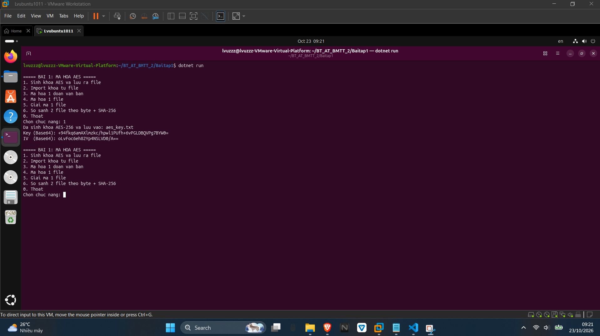
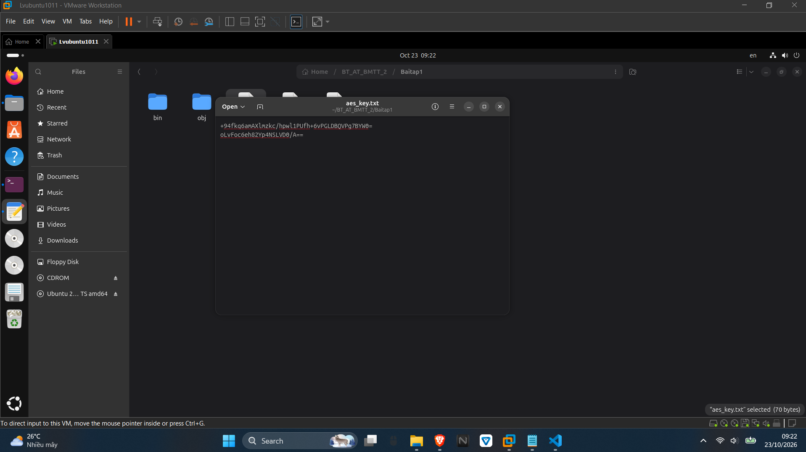
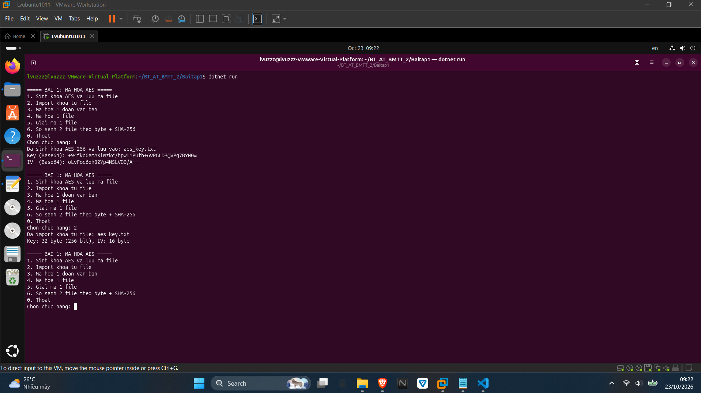
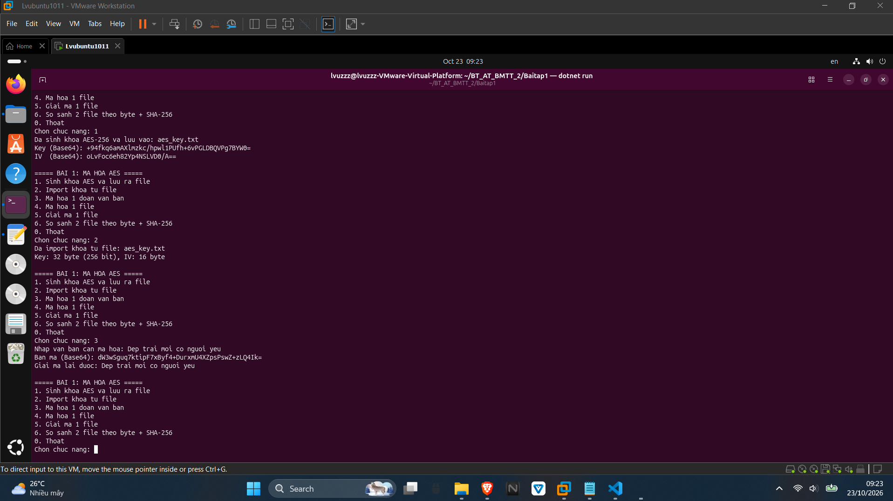
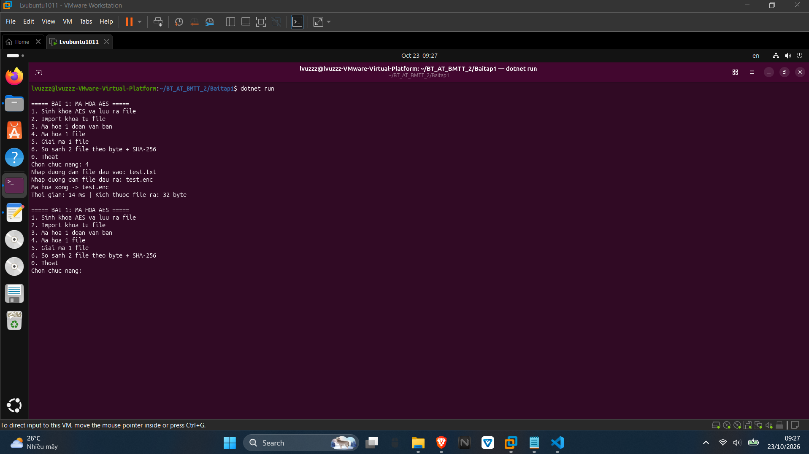
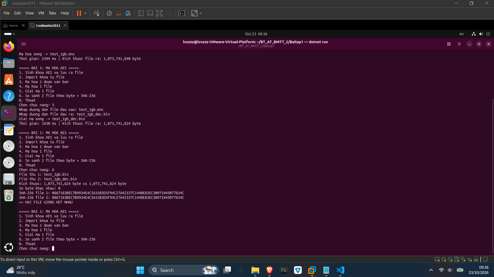

### BÀI TẬP 1
Bài tập thực hành mã hoá AES — thuật toán mã hoá đối xứng (mã hoá và giải mã dùng chung một khoá). Chương trình được viết bằng .NET (C#) dạng console, thực hiện trên Ubuntu, gồm các chức năng theo đúng thứ tự yêu cầu: sinh khoá AES, lưu khoá ra file, import khoá từ file, mã hoá một đoạn văn bản, mã hoá một file và thử nghiệm đo hiệu năng với file có kích thước lớn (hàng GB).
Source code của bài nằm trong thư mục `Baitap1` (file `Program1.cs`), chạy bằng lệnh:
```
dotnet run
```
## 1. Xây dựng chương trình mã hoá AES
Chương trình dùng AES-256 (khoá dài 32 byte), chế độ CBC với IV 16 byte và padding PKCS7.
# 1.1. Sinh khoá AES
Sử dụng lớp `Aes` của .NET để sinh ngẫu nhiên một khoá AES-256 và một IV:
```csharp
using (Aes aes = Aes.Create())
{
    aes.KeySize = 256;
    aes.GenerateKey();
    aes.GenerateIV();
}
```
Kết quả: chương trình sinh được khoá và IV ngẫu nhiên, hiển thị ra màn hình dạng Base64:
```
Key (Base64): +94fkq6amAXlnzkc/hpw11PUfh+6vPGLDBQVPg7BYW0=
IV  (Base64): oLvFoc6eh82Yp4NSLVD0/A==
```


# 1.2. Lưu khoá ra file
Khoá và IV được chuyển sang dạng Base64 và ghi ra file `aes_key.txt` (dòng 1 là Key, dòng 2 là IV) để dễ lưu trữ và đọc lại:
```csharp
string[] lines =
{
    Convert.ToBase64String(aes.Key),
    Convert.ToBase64String(aes.IV)
};
File.WriteAllLines("aes_key.txt", lines);
```
Kết quả: file `aes_key.txt` được tạo với đúng 2 dòng Base64 như trên.


# 1.3. Import khoá từ file
Đọc 2 dòng trong file `aes_key.txt`, giải mã Base64 để lấy lại đúng khoá và IV ban đầu:
```csharp
string[] lines = File.ReadAllLines("aes_key.txt");
byte[] key = Convert.FromBase64String(lines[0]);
byte[] iv  = Convert.FromBase64String(lines[1]);
```
Kết quả: chương trình import thành công và báo `Key: 32 byte (256 bit), IV: 16 byte` — đây là khoá dùng cho mọi thao tác mã hoá/giải mã tiếp theo.


# 1.4. Mã hoá một đoạn văn bản
Văn bản nhập từ bàn phím được chuyển thành mảng byte UTF-8, mã hoá bằng khoá vừa import và in kết quả ra màn hình dưới dạng Base64. Chương trình đồng thời giải mã lại để kiểm chứng:
```csharp
byte[] cipherBytes = enc.TransformFinalBlock(plainBytes, 0, plainBytes.Length);
Console.WriteLine("Ban ma (Base64): " + Convert.ToBase64String(cipherBytes));
```
Kết quả thực tế:
```
Nhap van ban can ma hoa: Dep trai moi co nguoi yeu
Ban ma (Base64): dw3wSguq7ktipF7xByf4+DurxmU4XZpsPswZ+zLQ4Ik=
Giai ma lai duoc: Dep trai moi co nguoi yeu
```
Bản mã Base64 hoàn toàn khác văn bản gốc, giải mã lại thu được đúng văn bản ban đầu.


# 1.5. Mã hoá một file
File được xử lý theo luồng (stream) bằng `CryptoStream` nên không cần nạp toàn bộ file vào RAM — xử lý được file hàng GB. Quá trình mã hoá và giải mã đều được đo thời gian bằng `Stopwatch`:
```csharp
using (CryptoStream cs = new CryptoStream(fsOut, aes.CreateEncryptor(), CryptoStreamMode.Write))
{
    fsIn.CopyTo(cs);
}
```
Kết quả thực tế với file `test.txt` (23 byte): mã hoá ra file `test.enc` có kích thước 32 byte trong 14 ms (lớn hơn file gốc 9 byte do padding PKCS7 bổ sung cho đủ block 16 byte); giải mã `test.enc` ra file `done.txt` thu lại đúng 23 byte trong 2 ms.

---

# 1.6. Đo thời gian mã hoá và giải mã
Tạo file dữ liệu ngẫu nhiên có kích thước 1 GB để thử nghiệm:
```
dd if=/dev/urandom of=test_1gb.bin bs=1M count=1024
```
Mã hoá file `test_1gb.bin` → ghi lại thời gian, sau đó giải mã file vừa mã hoá → ghi lại thời gian. Kết quả đo được trên máy:
Kích thước file	Thời gian mã hoá (ms)	Thời gian giải mã (ms)	Kích thước file mã hoá (byte)	Số byte khác nhau sau giải mã
1 GB	2394	1630	1.073.741.840	0
Với file 1 GB (1.073.741.824 byte): mã hoá mất 2394 ms (tốc độ khoảng 448 MB/s), file mã hoá lớn hơn file gốc đúng 16 byte do padding; giải mã mất 1630 ms (khoảng 659 MB/s) và thu lại đúng kích thước gốc 1.073.741.824 byte.


# 1.7. So sánh file nguồn và file giải mã theo byte
Chương trình đọc song song hai file (file nguồn `test_1gb.bin` và file sau giải mã `test_1gb_dec.bin`), đếm số byte khác nhau theo từng vị trí, đồng thời đối chiếu mã băm SHA-256 của hai file. Kết quả:
```
Kich thuoc: 1,073,741,824 byte vs 1,073,741,824 byte
So byte khac nhau: 0
SHA-256 file 1: 0067183BEC7B9934E4C5A31B5D5F94C27A42337C1440E83EC30971945077834C
SHA-256 file 2: 0067183BEC7B9934E4C5A31B5D5F94C27A42337C1440E83EC30971945077834C
=> HAI FILE GIONG HET NHAU
```

---

## Kết quả
Hoàn thành các yêu cầu của Bài tập 1:
- Sinh được khoá AES-256, lưu khoá ra file và import lại chính xác (Key 32 byte, IV 16 byte).
- Mã hoá được văn bản, in bản mã Base64 ra màn hình và giải mã lại đúng văn bản gốc.
- Mã hoá được file, kể cả file có kích thước hàng GB nhờ xử lý theo stream: file 1 GB mã hoá trong 2394 ms, giải mã trong 1630 ms.
- So sánh theo byte và theo SHA-256 đều cho thấy file giải mã giống hệt file nguồn (0 byte khác nhau, mã băm trùng khớp).
Kết luận: AES có tốc độ rất nhanh (hàng trăm MB/s), thời gian xử lý tăng theo kích thước file, phù hợp để mã hoá dữ liệu có kích thước lớn. Điểm cần lưu ý là phải bảo vệ file khoá cẩn thận, vì chỉ cần một khoá là có thể giải mã toàn bộ dữ liệu.
